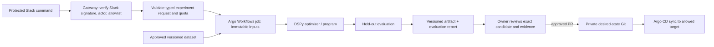

# DRAFT: Dots DSPy Refinery Architecture

Public architecture proposal only. No service, cluster, model call, data pipeline, credential, or cloud resource is deployed by this repository. All examples are synthetic. The private desired-state repository, if ever created, is separate from this public proposal.

This proposal extends the [public Dots local sidecar cloud infrastructure draft](https://github.com/newdarwindev/dots-local-sidecar-cloud-infrastructure). It does not copy private monorepo content or use Slack history as training data.

## Default decisions

| Concern | Default | Revisit when |
| --- | --- | --- |
| Execution | Typed gateway request creates an Argo Workflows experiment job | A simpler single-worker queue proves sufficient |
| Deployment | Argo CD reconciles reviewed Git changes; it does not run experiments | Never conflate deployment with job execution |
| Optimization | DSPy prompt/program optimization on an approved, versioned training set | Explicit separate fine-tuning proposal is approved |
| Workspace | JupyterHub with KubeSpawner and persistent volumes for approved researchers | BinderHub is wanted for ephemeral public demos only |
| ML platform | No Kubeflow initially | Multiple teams need its pipeline/metadata facilities |
| Identity | Keycloak OIDC for human UI sign-in; service identities for API/workflows | Existing organization IdP can replace Keycloak |
| Portal | Homepage links to services | It must never act as downstream authorization |
| Observability | Prometheus/Grafana/Loki for infrastructure; Langfuse for LLM traces and evaluations | Retention and privacy needs are measured |
| Secrets | OpenBao and External Secrets Operator (ESO), scoped per cluster | Version-pinned integration and recovery tests fail |
| GPU | CPU-only initial pilot | GPU model, passthrough, driver, plugin and budget are verified |

## Data flow and trust boundaries

Slack text is untrusted input, not executable instructions or a dataset. The gateway validates Slack request signatures and replay window, maps actor to a scoped identity, checks an allowlist and rate/cost quotas, and accepts only a typed request. It never passes arbitrary Slack text into a shell or model prompt. A job can read only its approved dataset version and scoped model endpoint; it cannot modify deployment Git. An immutable artifact records program/prompt version, dataset hashes, optimizer/model versions, run ID, metrics, and provenance. Held-out examples stay out of optimizer inputs. Promotion requires owner review of the exact artifact, evaluation, regression and privacy report; branch protection and Argo CD destination restrictions enforce the later deployment boundary. No automatic promotion.

Gold labels require human review, source provenance, consent/right-to-use review, and split/version tracking. Private Slack history is never automatically harvested for labels or training. Fine-tuning is a separate explicit mode with separate approval, data rights, spend controls, and evaluation.

## Scope and phases

1. **Paper design:** review inventory, data classification, model/provider choice, quotas, and threat model. No installation.
2. **Local offline prototype:** synthetic fixtures, typed validation, deterministic evaluator, artifact manifest. No model call or secret.
3. **Controlled pilot (future approval):** approved dataset and endpoint, bounded Argo Workflows jobs, traces, owner review. Establish CPU/memory/storage and token ceilings before runs.
4. **Promotion (future approval):** review a Git PR containing a pinned artifact reference, then let Argo CD reconcile only its permitted target.

A notebook-based cluster may sleep or disconnect. The source draft does not establish reliable capacity. Assume one concurrent CPU job, capped runtime, and no GPU until measured inventory supports more. Model token cost, storage retention, and any cloud egress must be budgeted and approved before phase 3. Keep data, secrets, and raw traces out of this public repository.

See [contracts](docs/contracts.md), [installation plan](docs/install-plan.md), [acceptance checklist](docs/acceptance.md), and [sources](docs/sources.md). The [synthetic request](examples/experiment-request.json) illustrates the contract; it is not a working deployment configuration.

## Attribution

Architecture ideas are original synthesis based on linked public documentation. No upstream code or documentation is vendored. The linked public Dots draft remains under its own license and attribution; links do not transfer a license to this repository. This repository's text is offered under [CC BY 4.0](LICENSE).
